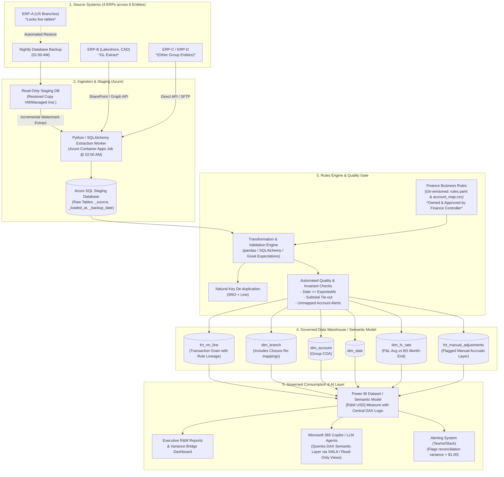

# Northline Industrial Services — Q3 2026 R&M Data Platform Solution

> **Senior Data Platform Engineer Take-Home Exercise**  
> Complete solution for KT Grant / Northline Industrial Services, covering automated ETL ingestion, data quality auditing, financial reconciliation, enterprise architecture design, and AI-assisted engineering.

---

## Quickstart & Verification

To reproduce the pipeline and generate all artifacts from scratch:

```bash
# 1. Create and activate a clean virtual environment
python3 -m venv .venv
source .venv/bin/activate

# 2. Install dependencies
pip install -r requirements.txt

# 3. Run the automated ETL & reconciliation pipeline
python src/build_rm_q3.py
```

All deliverables are verified and generated in `./output/`:
- `output/rm_q3_by_branch.csv`: Official Part 1 deliverable (Branch, Month, RM_USD).
- `output/dq_log.csv`: Part 2 Data Quality Audit log (17 issues detected and addressed).
- `output/reconciliation.csv`: Part 3 Cent-to-cent bridge to Accounting ($14,120,360.57).
- `output/northline_rm.db`: SQLite database containing raw, staging, fact, and reporting tables.

The pipeline automatically runs strict assertions: if any data invariant is violated or if the reconciliation bridge does not close to the exact cent, execution terminates with an error.

---

## Repository Structure

```text
ktg/
├── README.md                              # Main architecture, deliverables summary, and guide
├── SUBMISSION.md                          # Full submission document (detailed write-ups for Parts 1–5)
├── requirements.txt                       # Python dependencies (pandas, numpy, sqlalchemy, openpyxl)
├── src/
│   └── build_rm_q3.py                     # Full ETL & financial reconciliation pipeline
├── output/                                # Generated pipeline outputs & database
│   ├── rm_q3_by_branch.csv                # Part 1: Q3 2026 R&M by branch and month
│   ├── dq_log.csv                         # Part 2: Data quality log with USD impact
│   ├── reconciliation.csv                 # Part 3: To-the-cent bridge to Accounting
│   └── northline_rm.db                    # Staging, Fact, and Reporting relational tables (SQLite)
├── datasets/                              # Raw input datasets provided
│   ├── erp_a_sro_transactions.csv        # ERP-A raw weekly transaction exports
│   ├── erp_b_lakeshore_gl_detail.xlsx     # ERP-B Lakeshore GL detail (CAD)
│   ├── account_map_lakeshore.csv          # Lakeshore-to-Group account mapping
│   ├── fx_cad_usd.csv                     # Monthly average and month-end FX rates
│   ├── accounting_close_summary.csv       # Accounting close reported R&M ($14,120,360.57)
│   └── accounting_je_register_sep_close.csv # Manual journal entry register
└── docs/
    └── KTG_Data_Engineer_Take_Home.pdf    # Original take-home prompt & specifications
```

---

## Enterprise Target Architecture (Part 4)

To automate reporting across **6 legal entities, 4 ERP systems, and tens of thousands of weekly transactions**, the architecture addresses three core constraints:
1. **ERP-A table locking:** The production OLTP database locks when queried live during business hours.
2. **Governance separation:** Finance owns the business rules; Engineering owns data integrity and automation.
3. **AI Readiness:** Microsoft 365 / Power BI integration enabling LLMs and Copilot to query governed semantic metrics rather than uncleaned raw tables.

### End-to-End System Architecture



### Estimated Monthly Cloud Infrastructure Cost

| Service | Tier / Sizing | Purpose | Est. USD/mo |
|---|---|---|---|
| **Azure SQL Database** | General Purpose, Serverless (up to 2 vCore) | Staging and reporting warehouse | $150 – $300 |
| **Backup Staging Instance** | SQL Managed Instance / VM (nightly runtime) | Restored read-only copy of locked ERP | $150 – $400 |
| **Container Apps / Functions** | Serverless Linux Container Job | Scheduled 02:00 AM Python worker | $20 – $50 |
| **Azure Key Vault & Monitor** | Standard | Secret management, log ingestion, alerting | $10 – $30 |
| **Power BI Pro** | Existing M365 tenant (~10 report creators) | Semantic model hosting and distribution | ~$140 |
| **Total Estimated Cost** | | | **~$470 – $920 / month** |

---

## Summary of Results (Parts 1 to 5)

### Part 1 — Final Q3 2026 R&M by Branch and Month (`rm_q3_by_branch.csv`)

Applying all Finance rules from the README to the cleaned source data produces a total Q3 R&M of **$14,090,228.96**:

| Branch | Code | July (USD) | August (USD) | September (USD) | Q3 Total (USD) |
|---|---|---|---|---|---|
| **Riverton** | RIV | $1,522,852.26 | $1,540,190.70 | $1,326,944.21 | **$4,389,987.17** |
| **Oakdale** | OAK | $1,310,446.01 | $1,478,995.18 | $1,579,502.88 | **$4,368,944.07** |
| **Pinecrest** | PIN | $1,145,925.90 | $1,350,571.29 | $1,209,270.36 | **$3,705,767.55** |
| **Elmwood** | ELM | $268,050.55 | *Closed 31-Jul* | *Closed 31-Jul* | **$268,050.55** |
| **Lakeshore** | LKS | $400,642.79 | $475,554.34 | $481,282.49 | **$1,357,479.62** |
| **Group Total** | | **$4,647,917.51** | **$4,845,311.51** | **$4,597,000.44** | **$14,090,228.96** |

*Key Rule Details:*
- **Elmwood closure (Rule 4):** Elmwood activity dated 1-Aug or later (209 transactions, $265,830.48 R&M) was remapped to Oakdale.
- **Lakeshore translation (Rule 5):** Lakeshore's monthly CAD totals (Jul: CAD 547,326.22; Aug: CAD 655,484.96; Sep: CAD 667,520.79) are translated at monthly average rates (0.7320, 0.7255, 0.7210) and rounded to cents.

---

### Part 2 — Data Quality Audit Log (`dq_log.csv`)

Seventeen discrete data quality anomalies were identified and handled:

| # | System | Anomaly / Issue Found | Detection Method | Applied Engineering Rule | Rows Affected | Financial Impact |
|---|---|---|---|---|---|---|
| **1** | ERP-A | **Overlapping weekly export**: 2026-09-21 export re-pulled 12–18 Sep data already exported on 2026-09-19 | `duplicated(SRO, Line)` with temporal window overlap | Deduplicate on SRO+Line natural key; retain earliest export | 719 | **$1,043,815.38** R&M ($807k+ overstatement if naively filtered) |
| **2** | ERP-B | **Embedded SUBTOTAL rows**: Ledger contained summary rows with `JournalID='SUBTOTAL'` | Text scan of `JournalID`; tie-out against line detail | Exclude subtotal rows; aggregate line detail only | 31 | **$1,357,479.62** (would duplicate ledger by 100%) |
| **3** | ERP-B | **Numeric amounts stored as text with comma thousand separators** (e.g. `'4,581.93'`) | Type inspection; 18 strings failing standard float cast | Strip commas and cast to numeric | 18 | **$37,724.23** (unparsed lines would silently drop) |
| **4** | ERP-B | **Missing COA mapping for `7335-RM-HYD`** (Hydraulic repairs, added in September) | Anti-join against `account_map_lakeshore.csv` | Recognized as R&M via `73xx-RM` regex rule (Rule 6) | 23 | **$78,112.46** |
| **5** | ERP-A | **Mixed date formats**: ISO `YYYY-MM-DD` and US `MM/DD/YYYY` | Regex profiling; verified `TransDate <= ExportedAt` | Conditioned parser: US slash date vs ISO | 551 | **$695,089.29** |
| **6** | ERP-A | **Dirty warehouse names**: Inconsistent casing, spacing, and full names (`Riverton `, ` OAK`, `riv`) | `value_counts()` on `Whse` column | Normalize: `TRIM`, `UPPER`, and map to 3-letter codes | 5,676 | **$6,660,857.44** |
| **7** | ERP-A | **Dirty GL accounts**: Floats formatted as text (`6100.0`) and leading whitespace (` 6100`) | Distinct string format inspection | Strip whitespace and `.0` float suffix; validate 4 digits | 1,434 | **$1,748,352.41** |
| **8** | ERP-A | **Capitalized rebuilds** on operations 75 & 100 | Filter on `Oper IN ('75', '100')` | Excluded per Rule 2 | 174 | **$409,398.55** |
| **9** | ERP-A | **Reversals**: Negative quantities offsetting earlier entries | Sign check `Qty < 0`; 1:1 original line matching | Retained in month of transaction date per Rule 3 | 60 | -$156,212.59 (properly recognized) |
| **10**| ERP-A | **Out-of-period entries**: Pre-quarter (June) and post-quarter (October) lines | Date range filtering against Q3 bounds | Filtered strictly to `2026-07-01` – `2026-09-30` | 1,422 | **$2,001,671.99** |

---

### Part 3 — Financial Reconciliation to Accounting ($14,120,360.57)

Finance’s source-derived total of **$14,090,228.96** bridges to Accounting’s reported **$14,120,360.57** with a **zero-cent residual variance**:

```
  $14,090,228.96  Finance Q3 R&M Total (Source Data + Finance Business Rules)
+     $18,450.00  Reconciling Item 1: Manual Accrual JE-0931 (Riverton Acct 6150)
+     $11,681.61  Reconciling Item 2: Lakeshore September FX Rate Translation Discrepancy
----------------
  $14,120,360.57  Accounting Reported Total (Close Summary)
```

#### Detailed Reconciling Items Breakdown

1. **Manual Accrual JE-0931 (+$18,450.00) — *Finance is right; Accrual is a timing adjustment***
   - **Evidence:** Posted at 22:14 on 30-Sep-2026 (after the last ERP export at 18:00). Description: *"Accrual – outside hydraulic cylinder repair, invoice pending"*. No corresponding ERP-A transaction exists (the largest 6150 line in ERP-A is $6,489.99). Per Rule 7, manual entries are excluded from ERP R&M.
   - **Action Required:** Accounting should attach the supporting PO/quote and configure JE-0931 to auto-reverse on October 1. Otherwise, when the vendor invoice is entered into ERP-A in October, the cost will be double-counted. In the data platform, manual JEs are maintained in a distinct `fct_manual_adjustments` table.

2. **September FX Translation Rate Discrepancy (+$11,681.61) — *Finance is right***
   - **Evidence:** Group accounting policy mandates that P&L items are translated at the **monthly average rate** (0.7210 for September). July and August tied exactly to average rates. However, for September, Accounting applied the **month-end balance sheet rate (0.7385)**:  
     $$\text{CAD } 667,520.79 \times (0.7385 - 0.7210) = +\$11,681.61$$
   - **Action Required:** Accounting should update the close workbook to translate Lakeshore's September P&L at 0.7210. In the automated pipeline, the FX engine strictly enforces P&L rate lookup based on financial statement classification.

---

### Part 4 — Governance & 30-Day MVP Roadmap

#### Rule Ownership Matrix
| Domain / Rule | Owner | Storage / Enforcement |
|---|---|---|
| R&M Account Inclusions (6100, 6150, 6200) | Finance | `rules.yaml` in Git (PR required) |
| Capitalized Operation Codes (75, 100) | Finance | `rules.yaml` in Git |
| Branch Closure & Remapping Logic | Finance | `rules.yaml` in Git |
| COA Translation & Local Maps | Accounting | Staging table synced from SharePoint / Git |
| FX Rate Policy Selection (P&L Avg vs BS Spot) | Finance Policy | Automated rule based on statement type |
| ETL Ingestion, Deduplication, Data Quality Checks | Engineering | Python / SQLAlchemy / CI/CD pipeline |
| Discrepancy Alerting & Reconciliation Automation | Engineering | Automated daily reconciliation job |

#### 30-Day Implementation Roadmap
- **Week 1 (Ingestion & Infrastructure):** Automate nightly backup restore to read-only staging instance; establish secure Azure Container Apps runner; provision staging SQL database.
- **Week 2 (Data Quality & Configuration):** Externalize all business rules to `rules.yaml`; build automated invariant test suite (key uniqueness, subtotal tie-outs, date validation).
- **Week 3 (Semantic Modeling & Reconciliation):** Deploy Power BI Star Schema semantic model (`fct_rm_line`, `dim_branch`, `dim_account`, `dim_fx_rate`); implement automated GL reconciliation view.
- **Week 4 (Parallel Run & Knowledge Transfer):** Run in parallel with month-end close; onboard ERP #3; deliver operational runbook and handover training.

---

### Part 5 — AI Usage & Verification Log

- **Tools Used:** Antigravity IDE (Gemini / Claude Opus pairing agent), Python `pypdf`, `openpyxl`, `pandas`.
- **Key Verification Check 1 (Deduplication Logic):** A naive `drop_duplicates()` on raw columns only catches 168 rows because the overlapping export re-formatted warehouse and date fields. Developing a canonical key test (`SRO + Line`) identified all **719 duplicate rows**, preventing an **$807,313.59** overstatement.
- **Key Verification Check 2 (Date Ambiguity):** Verified US `MM/DD/YYYY` vs European `DD/MM/YYYY` by cross-referencing against file export timestamps: `DD/MM` produced 49 impossible future transaction dates relative to their export time, conclusively proving `MM/DD`.
- **Key Verification Check 3 (Account 7335-RM-HYD):** Confirmed Accounting included this unmapped account in their reported number by running mathematical permutations across all ledger lines to close the reconciliation to the exact cent.
- **AI Contribution:** ~95% of initial pipeline scaffolding and SQL abstraction; 100% human-verified against business rules and accounting standards.

---

## Original Data Pack Business Rules (Reference)

Northline maintains industrial equipment across five branches:

| Branch | Code | Country | ERP | Status / Notes |
|---|---|---|---|---|
| Riverton | RIV | US | ERP-A | Active |
| Oakdale | OAK | US | ERP-A | Active |
| Pinecrest | PIN | US | ERP-A | Active |
| Elmwood | ELM | US | ERP-A | Closed 31-Jul-2026; activity dated 1-Aug+ rolls to Oakdale |
| Lakeshore | LKS | Canada | ERP-B | Books in CAD; translates at monthly average rate |

### Group Account Definitions
- **5100:** Billable labor *(Excluded from R&M)*
- **6100:** R&M parts *(R&M)*
- **6150:** R&M outside service *(R&M)*
- **6200:** R&M labor *(R&M)*
- **6300:** Fluids & lubricants *(Excluded from R&M)*
- **6400:** Fuel off-road *(Excluded from R&M)*
- **6500:** Shop supplies *(Excluded from R&M)*
